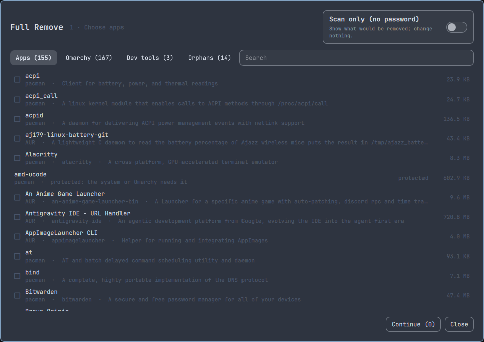

# Full Remove

An Omarchy panel that uninstalls apps and cleans up what they leave behind:
pacman and AUR packages, Flatpaks, Snaps, AppImages and global dev tools.
Leftover folders go to the Trash, and orphans the removal created are offered
at the end.



**Contents:** [What it does](#what-it-does) · [Install](#install) ·
[Usage](#usage) · [Uninstall](#uninstall) · [Updating](#updating) ·
[Security](#security) · [Development](#development)

## What it does

Omarchy's Remove > Package runs `pacman -Rns` and stops there. Full Remove also:

- removes Flatpaks, Snaps, AppImages and dev tools (npm, bun, uv, pipx, cargo,
  go, gem) from the same list
- finds leftovers in `~/.config`, `~/.local/share`, `~/.local/state`, `~/.cache`,
  `~/.var/app`, `~/snap`, dot-folders in `~`, the yay/paru build cache, and the
  package's files in `/var/cache/pacman/pkg`
- moves leftovers to the Trash instead of deleting them
- shows every command before it runs, including the one that runs as root
- has a scan-only mode that needs no password and changes nothing

Needs Omarchy 4.x with `python3`, `gio` and `polkit` (all on a normal install).
`flatpak`, `snapd`, `xdg-user-dirs` and the dev tool managers are optional;
anything missing is skipped. The plugin makes no network calls.

## Install

Setup is manual because a small root helper has to be installed root-owned
([why](#security)). Without it, scan-only mode, user Flatpaks, AppImages and
dev tools still work.

1. Install the plugin:

   ```bash
   omarchy plugin add https://github.com/Rockeyxx/omarchy-plugin-full-remove --enable
   ```

2. Read the two files in `root/`, then install the helper from a fresh clone:

   ```bash
   git clone https://github.com/Rockeyxx/omarchy-plugin-full-remove /tmp/full-remove
   cd /tmp/full-remove/root
   less full-remove-helper io.github.rockeyxx.full-remove.policy
   makepkg -si
   ```

   This builds the `full-remove-helper` package from those local files. Without
   makepkg:

   ```bash
   sudo install -Dm755 -o root -g root full-remove-helper /usr/lib/full-remove/full-remove-helper
   sudo install -Dm644 -o root -g root io.github.rockeyxx.full-remove.policy \
     /usr/share/polkit-1/actions/io.github.rockeyxx.full-remove.policy
   ```

3. Add it under Remove in `~/.config/omarchy/extensions/omarchy-menu.jsonc`:

   ```jsonc
   "remove.full-remove": {
     "icon": "󰩺",
     "label": "Full remove",
     "action": "omarchy-shell shell summon io.github.rockeyxx.full-remove '{}'"
   }
   ```

4. Optional keybind in `~/.config/hypr/bindings.lua`:

   ```lua
   o.bind("SUPER + ALT + DELETE", "Full Remove", "omarchy-shell shell summon io.github.rockeyxx.full-remove '{}'")
   ```

## Usage

1. **Choose.** Tick what to remove and press Continue. Turn on *Scan only* to
   just look.
   - **Apps:** what you installed that shows in the app launcher (pacman, AUR,
     Flatpak, Snap, AppImage)
   - **Omarchy:** what Omarchy's installer put there
   - **Dev tools:** runtimes and toolchains (python, nodejs, go, rust, JDK,
     dotnet, clang, gdb...) plus global npm/bun/uv/pipx/cargo/go/gem installs
   - **CLI & services:** what you installed that has no launcher: daemons, CLI tools,
     fonts, libraries (acpid, github-cli, ttf-dejavu...). Removable like apps.
   - **System:** kernels, firmware, drivers, bootloader, and anything the system
     or Omarchy depends on. View only.
   - **Orphans:** orphans and unused Flatpak runtimes that already exist
2. **Review.** See what pacman also removes, which cache files go, and every
   command. If a removal would break another package, Confirm stays off and the
   panel names the package.
3. **Remove.** Root work asks for your password and the log streams into the
   panel. Closing the panel lets the running step finish and cancels the rest.
4. **Leftovers.** Clear matches are ticked; weaker ones are marked *maybe* and
   left unticked. Move to Trash, or *Delete permanently* after a second confirm.
5. **Cleanup.** Only orphans and runtimes this removal created. Skipped if
   there are none.
6. **Done.** *Empty this run's items from Trash* deletes only what this run
   moved there.

Scan-only mode ends in a report you can copy or export to Downloads.

Keys: ↑/↓ move, Space tick, Enter continue, Tab switch tabs, `/` or Ctrl+F
search, Esc leave search, then close.

Logs for the current boot are in `/run/user/<uid>/full-remove/`. pacman also
logs every removal to `/var/log/pacman.log`.

## Uninstall

```bash
omarchy plugin remove io.github.rockeyxx.full-remove
sudo pacman -R full-remove-helper
```

If you installed the helper by hand:

```bash
sudo rm /usr/lib/full-remove/full-remove-helper \
  /usr/share/polkit-1/actions/io.github.rockeyxx.full-remove.policy
sudo rmdir /usr/lib/full-remove
```

Then delete the `remove.full-remove` menu entry and the keybind, if you added
them.

## Updating

Plugins run with your full user rights, so read the changes first:

```bash
cd ~/.config/omarchy/plugins/io.github.rockeyxx.full-remove
git fetch && git log -p HEAD..origin/main
omarchy plugin update io.github.rockeyxx.full-remove
```

If `root/` changed, the panel says the helper is outdated. Read the new files
and reinstall the helper from a fresh clone (Install, step 2).

## Security

Omarchy plugins are not sandboxed. Read the code before installing or updating
this one, especially `root/full-remove-helper` (about 200 lines of bash).

**The root helper lives outside the plugin.** The plugin folder is writable by
your user, so anything running as you (a bad AUR package, an exploited app,
another plugin) could swap root code kept there and wait for your next
password. The helper is installed root-owned in `/usr/lib/full-remove/`, the
polkit action is pinned to that path, and the panel refuses a helper that
isn't root-owned.

**Your password is asked every time.** The action uses `auth_admin`, with no
caching and no sudoers rule. The prompt shows the exact command, for example
`Full Remove: /usr/lib/full-remove/full-remove-helper remove pkg:sl`. Only
type your password if you just pressed Confirm and it matches the panel.

**The helper accepts only these items**, all checked before anything runs:

- `pkg:<name>`: matches `^[a-z0-9][a-z0-9@._+-]*$` and is installed under
  exactly that name; passed to pacman after `--`
- `flatpak:<app-id>`: an installed system Flatpak app
- `snap:<name>`: an installed snap, never `snapd`, `core*` or `bare`
- `orphan:<name>`: still an orphan when the helper runs
- `runtime:runtime/<id>/<arch>/<branch>`: an installed system runtime

It takes no paths or commands, uses no temp files and reads no environment
variables. It finds cache files itself, only directly in `/var/cache/pacman/pkg`,
without following symlinks, and only when the package name matches exactly.

**It refuses essential packages:** kernels, bootloader, glibc, systemd, pacman,
sudo, polkit, PAM, firewall/AppArmor/audit tools, and anything Omarchy depends
on. It also refuses when pacman can't work out what a removal would take with
it.

**Home cleanup never runs as root.** Leftovers go to the Trash, and symlinks
are moved as links (their targets stay). Only direct children of the folders
listed in [What it does](#what-it-does) can be moved, so Documents, Pictures
and the like are off limits. If trashing fails, the item stays put.

**Known limits:**

- A package's own pre/post-remove script runs as root during removal. It had
  root at install time too.
- Code already running as you could fake a password prompt or read input in
  the shell, since Omarchy's polkit agent runs in the same process as every
  plugin. Local polkit rules, like Arch's `empower` group, can skip the
  password.
- Flatpak lets wheel users remove system Flatpaks without a password anyway;
  the helper adds a prompt but no real protection there.
- Installing the helper is a trust step, like any AUR package. Build it from a
  fresh clone you've read.
- Malware that already has root is out of scope.

## Development

```bash
PYTEST_DISABLE_PLUGIN_AUTOLOAD=1 python3 -m pytest -q tests/
shellcheck root/full-remove-helper
qmllint -I /usr/share/omarchy/shell Panel.qml ItemRow.qml
omarchy plugin validate .
```

After editing QML in an installed copy, run `omarchy-restart-shell`; hot reload
can keep serving the old panel.

## License

MIT. See [LICENSE](LICENSE).
